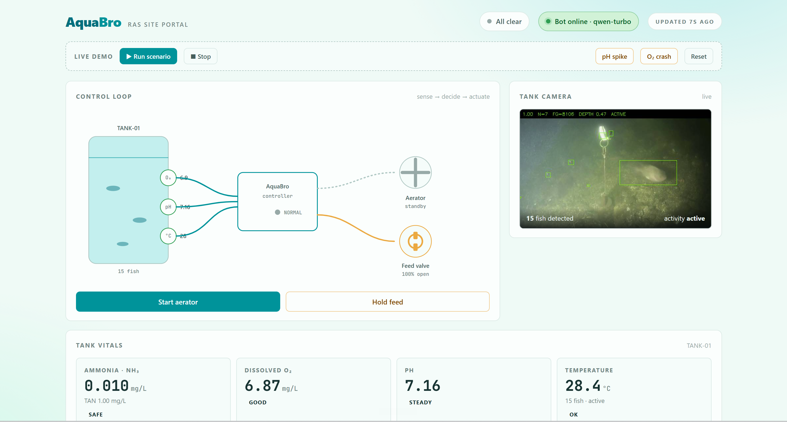
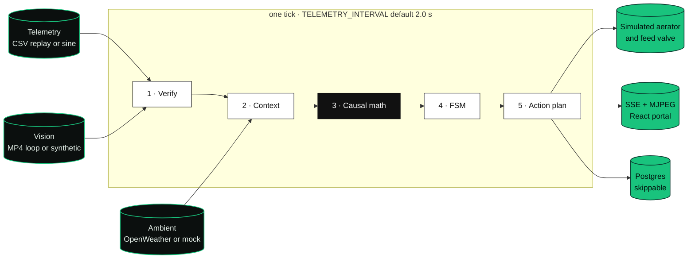
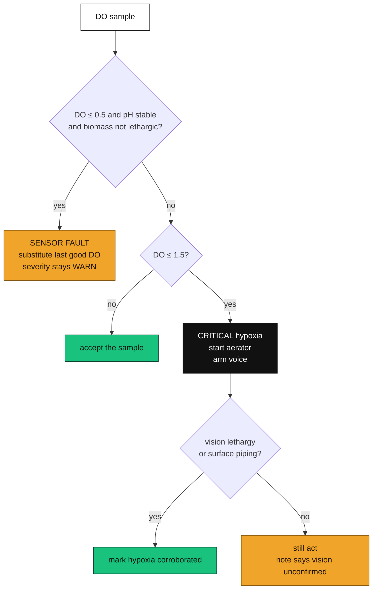
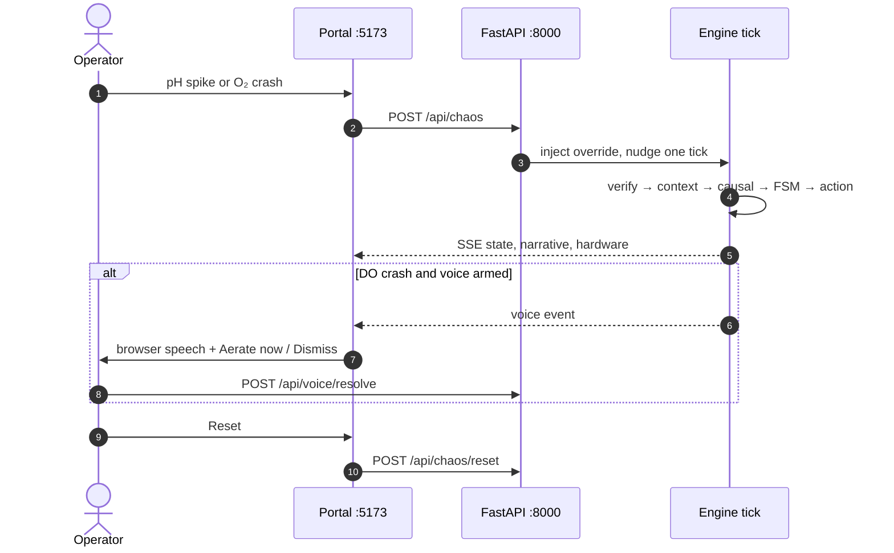

<p align="center">
  
</p>

<p align="center">
  <b>Tell a dead probe from a dying tank, then aerate or stop the feed.</b><br>
  <sub>One Python process. Ammonia fraction from pH and temperature. Motion vision as a second opinion. The spec calls this AquaPulse AI. The codebase is AquaBro.</sub>
</p>

<p align="center">
  
  
  
  
  
  
  
  
</p>

---


## ▍Project gallery

<table><tr>
<td width="50%"></td>
<td width="50%"></td>
</tr></table>

<sub>Images from the [project portfolio](https://bede-lau.github.io/); they may depict an earlier build.</sub>

## ▍The problem

A recirculating aquaculture tank can lose its stock because a dissolved-oxygen probe shorts, or because the water actually ran out of oxygen. Those two events look alike on one number. Total ammonia is the other trap: the toxic part is the un-ionized fraction, and that fraction moves with pH and temperature. A chat model asked to "watch the tank" does not execute that equation, and it cannot tell a dead probe from a biological crash.

We run a fixed loop on one tank (`TANK-01`). Verify the sample. Estimate total ammonia from recent feed. Compute the toxic fraction. Step a state machine. Then command a simulated aerator or feed valve. Language models are optional, and only on the Telegram side channel.

## ▍The pipeline at a glance



| Stage | What it uses | What it decides |
| --- | --- | --- |
| **Verify** | DO, previous pH, vision lethargy / piping | DO ≤ 0.5 mg/L, pH moved &lt; 0.12, and no lethargy → sensor fault. Last good DO is kept. DO ≤ 1.5 mg/L with lethargy or piping → hypoxia corroborated. |
| **Context** | Feed events in the last 60 s, weather cache (5 min) | TAN = 0.20 + 0.020 × grams fed. No OpenWeather key → mock Puchong air, 31 °C, 82% humidity. |
| **Causal** | Emerson pKa(T), in-memory graph | Un-ionized NH₃ = fraction × TAN. Above 0.05 mg/L is toxic. A climb steeper than 0.002 mg/L per minute, or NH₃ above 80% of the threshold, is a warning. Trusted DO ≤ 1.5 mg/L is critical hypoxia. DO under 3.0 mg/L is a warning. A faulted probe stays a warning and does not start the aerator. |
| **FSM** | Max severity, whether a mitigation is on | `NORMAL` → `AT_RISK` → `CRITICAL` → `MITIGATING` → `RECOVERING` → `NORMAL`. Critical does not leave until an aerator is on or the feed valve is locked. |
| **Action** | Active risks | Critical hypoxia → aerator `ACTIVE` and a voice prompt. Toxic or climbing ammonia → feed rate × 0.5 and valve `LOCKED`. Critical risks queue a Telegram text. |

The graph is ten nodes in process memory (`Sensor → Parameter → Risk → Hardware`). It is not Neo4j. The same topology is what the API returns at `/api/causal/graph`.



`HYPoxIA_T_CRITICAL_S` is 180. The causal note quotes that window. Nothing in the loop counts down 180 seconds before it acts.

While an injected DO crash is overridden and the aerator is `ACTIVE`, each tick adds 0.6 mg/L to that override and clears it at 6.5 mg/L. That recovery is part of the demo, not a measured oxygen-transfer rate.

## ▍The demo

The committed still is the site portal: schematic, camera card, vitals.

<p align="center">
  <br>
  <sub><b>Baseline.</b> Portal on a healthy tick. Buttons in the current UI are Start system, Stop, pH spike, O₂ crash, and Reset.</sub>
</p>

Open `http://localhost:5173` after both processes are up. The bar talks to `POST /api/chaos`.

| Control | What it sends |
| --- | --- |
| **pH spike** | `{"ph": 8.7}` — toxic fraction climbs, feed valve locks |
| **O₂ crash** | `{"do": 1.2}` — hypoxia path, aerator on, voice overlay |
| **Reset** | clears overrides, hardware, FSM, NH₃ history |
| **Start aerator / Hold feed** | `POST /api/hardware/override`. The loop yields that device for 30 s |
| **Start system / Stop** | `POST /api/system/power`. Stop also cancels the narrator |

The voice card speaks a fixed hypoxia line with the browser `SpeechSynthesis` API and posts `execute` or `cancel` to `/api/voice/resolve`. ElevenLabs is used only when `VOICE_ENABLED=true` and both ElevenLabs keys are set. Pump and valve sounds are `frontend/public/sfx/pump.mp3` and `valve.mp3`. Those files are not in the tree. A missing file is ignored.

A scripted narrator lives at `POST /api/chaos/narrator` with `{"run": true}`. The dashboard does not call it. `frontend/src/api.ts` exports `setNarrator`; `App.tsx` never uses it. The script, in order, waits then acts: reset (1 s), pH 8.7 (6 s), reset (22 s), DO 1.2 (4 s), reset (22 s), then loops. The function comment calls this a 3-minute demo. The sleeps add up to 55 seconds per cycle.



There is no hosted demo URL in this repo.

## ▍Run it

Python 3.12, Node with npm, and Docker if you want Postgres. The pinned `asyncpg` and `pydantic-core` builds in `backend/requirements.txt` are why this tree stays on 3.12. A bare `python` that is 3.14 will fail those wheels. `start.bat` calls `python -m venv` with whatever `python` is on `PATH`.

Postgres is optional. If it is down, startup logs a warning and skips writes. Every external key is optional. A missing key puts that channel in mock mode.

```sh
git clone https://github.com/bede-lau/AquaBro && cd AquaBro
cp .env.example .env

docker compose up -d postgres

python3.12 -m venv .venv
source .venv/bin/activate
pip install -r backend/requirements.txt
```

Windows, without activation:

```cmd
py -3.12 -m venv .venv
.venv\Scripts\python.exe -m pip install -r backend\requirements.txt
.venv\Scripts\python.exe -m uvicorn app.main:app --reload --app-dir backend
```

`uv` is the other path already used here, if you have it: `uv venv --python 3.12 .venv` then `uv pip install -r backend/requirements.txt`.

Two processes. Run uvicorn from the repo root so `--app-dir backend` resolves `app.main:app` and `.env` stays at the root.

```sh
# terminal 1
uvicorn app.main:app --reload --app-dir backend

# terminal 2
cd frontend && npm install && npm run dev
```

Windows can also launch Postgres, the venv, and both windows with `start.bat`. `stop.bat` closes those windows and runs `docker compose down`.

| URL | What |
| --- | --- |
| `http://localhost:5173` | Site portal. Vite proxies `/api` to port 8000 |
| `http://localhost:8000/docs` | OpenAPI |
| `http://localhost:8000/api/stream` | SSE |
| `http://localhost:8000/api/vision/stream` | MJPEG. 503 if OpenCV is missing and no frame has been rendered |
| `http://localhost:8000/api/health` | `{"status":"ok"}` |
| `http://localhost:8000/api/state` | Latest tank snapshot |
| `http://localhost:8000/api/causal/graph` | Coloured graph for the current snapshot |

**No key needed to run the demo.** Weather, Telegram, ElevenLabs, and the operator LLM all no-op or mock when unset. Names below are the ones `backend/app/config.py` and `.env.example` actually read. Leave secrets in `.env` only.

| Variable | Role |
| --- | --- |
| `DATABASE_URL` | Async Postgres URL. Local defaults are in `.env.example` and `docker-compose.yml` |
| `OPENWEATHER_API_KEY` | Ambient air. Blank → mock. `OWM_LAT` / `OWM_LON` default to 3.0333, 101.6158 (Puchong) |
| `TELEGRAM_BOT_TOKEN`, `TELEGRAM_CHAT_ID` | Outbound alerts, and the only chat the inbound agent will answer |
| `TELEGRAM_AGENT_ENABLED` | Default true. The poller starts only when the bot token and chat id are both set |
| `LLM_API_KEY`, `LLM_BASE_URL`, `LLM_TEXT_MODEL` | OpenAI-compatible client for that Telegram agent. Model default is `qwen-turbo`. No key → keyword fallback |
| `ELEVENLABS_API_KEY`, `ELEVENLABS_AGENT_ID`, `VOICE_ENABLED` | Voice stays on browser speech until all three are set |
| `PUBLIC_BASE_URL` | Prefix for the ElevenLabs `trigger_aerator` webhook (`/api/hardware/override`) |
| `DATA_DIR`, `VISION_CLIPS_DIR`, `TELEMETRY_CSV` | Default `./data`, `./data/clips`, `./data/meta_tilapia_set.csv` |
| `VISION_DETECTOR`, `VISION_YOLO_WEIGHTS` | `motion` (default) or `yolo` |
| `VISION_FPS`, `TELEMETRY_INTERVAL` | Default 15 fps and 2.0 s |
| `APP_HOST`, `APP_PORT`, `LOG_LEVEL` | Default `0.0.0.0`, `8000`, `INFO` |

Clips and CSVs under `data/` are gitignored. The spec names the Zenodo tilapia set, DOI `10.5281/zenodo.17518786`, as the file to drop on disk. This commit only has `data/.gitkeep`.

```sh
# optional: 600 rows of healthy DO / pH / temp so replay is a CSV, not the sine
python backend/scripts/generate_telemetry_csv.py

# YOLO is not installed by default. Uncomment ultralytics in backend/requirements.txt,
# point VISION_YOLO_WEIGHTS at a weight file, and set VISION_DETECTOR=yolo.
```

The generator's own comment says those 600 rows are 12 minutes at a 1.2 s cadence. The engine advances one row per tick, and the default tick is 2.0 s.

### Tests

```sh
pytest backend/tests -q
```

Nineteen tests in four modules: ammonia math (`pKa` at 25 °C against 9.245), FSM transitions, probe-fault versus confirmed hypoxia, and the pipeline from a pH spike or a corroborated DO crash through to feed lock, aerator, and voice. The frontend `package.json` has `dev`, `build`, and `preview`. It has no test script.

Checklist, key signup, and the ngrok note for a live ElevenLabs tool: [`docs/MANUAL_TASKS.md`](docs/MANUAL_TASKS.md).

## ▍Repository map

```
AquaBro/
├── backend/app/
│   ├── main.py              FastAPI, SSE, chaos, hardware, voice, Telegram status
│   ├── engine.py            tick loop, chaos overrides, narrator, watt model
│   ├── config.py            env settings and mock flags
│   ├── agents/              telemetry · context · causal · action
│   ├── causal/              graph.py · math_models.py · fsm.py
│   ├── vision/              broadcaster (MJPEG) · motion / yolo / synthetic
│   └── integrations/        openweather · telegram · telegram_bot · elevenlabs · llm
├── backend/tests/           19 pytest functions
├── backend/scripts/generate_telemetry_csv.py
├── frontend/src/            Vite + React + TypeScript portal
├── docs/MANUAL_TASKS.md     keys, dataset, voice webhook, SFX
├── plan.txt                 spec the code was written against
├── docker-compose.yml       Postgres 16 only
├── start.bat · stop.bat     Windows launcher
├── screenshots/image.png    the still above
└── skills/                  agent-skill notes. The app does not import them
```

| Doc | |
| --- | --- |
| [docs/MANUAL_TASKS.md](docs/MANUAL_TASKS.md) | Dataset, Postgres, keys, SFX, voice webhook, troubleshooting |
| [plan.txt](plan.txt) | Hackathon spec: agents, equations, demo beats. Some of it was not built (see below) |
| [.env.example](.env.example) | Variable names and the local Postgres defaults |

`skills/` is a pile of writing and debugging notes checked into the tree. Nothing under `backend/` or `frontend/src/` imports it.

## ▍What this is, and isn't

We would rather be precise than impressive.

- The control loop does not call an LLM. The only model client is the optional Telegram operator (`llm_client.py`). With no `LLM_API_KEY` it matches keywords: status, ammonia, aerator, feed.
- Telemetry in a fresh clone is a sine around DO 6.6 mg/L, pH 7.15, 28.4 °C. A CSV is used only when `TELEMETRY_CSV` exists and has DO, pH, and temp columns. `generate_telemetry_csv.py` writes a seeded synthetic file. It is not the Zenodo log.
- `data/clips/` is empty in git. No clips, or no OpenCV, and vision is `SyntheticDetector`: a sine activity index, `fish_count` fixed at 24, and a stress flag the engine turns on when verified DO ≤ 2.0 mg/L. That flag is not inferred from video.
- Default vision on real frames is temporal frame differencing, not a trained detector. YOLOv8 is a stub path. `ultralytics` is commented out of `requirements.txt`. No weights ship here.
- [`docs/MANUAL_TASKS.md`](docs/MANUAL_TASKS.md) says a local Brackish extract (Aalborg) was copied into `data/clips/` on one machine, and that those clips have no DO/pH/temp. Those files are gitignored. We do not repeat detection counts from that note.
- The watt figure on the portal is a formula: 40 W baseline, +750 W if the aerator is on, +60 W if the feed valve is active. It is not a meter. Feed mass is also a formula: 10 g every 8 s while the valve is `ACTIVE`. TAN coefficients are marked demo-calibrated in `context.py`.
- Hardware is in-memory state plus HTTP. There is no PLC, relay, or RTSP camera. The "RTSP sim" is OpenCV reading local files.
- Postgres stores `telemetry_logs`, `auto_feed_logs`, and `agent_events` when it is up. The app runs without it.
- The spec asked for Neo4j, a Node webhook process, React Native, and an EC2 deploy. None of those are in this repo. The 180-second mortality constant is not a timer.

## ▍Credits

| | |
| --- | --- |
| Ammonia fraction | Emerson, Russo, Lund, and Thurston (1975), as cited in `backend/app/causal/math_models.py` |
| API | [FastAPI](https://fastapi.tiangolo.com/), uvicorn, sse-starlette, SQLAlchemy, asyncpg |
| Portal | [React](https://react.dev/), [Vite](https://vite.dev/) |
| Vision | [OpenCV](https://opencv.org/). Optional [Ultralytics](https://github.com/ultralytics/ultralytics) YOLO is not installed by default |
| Database | [PostgreSQL 16](https://www.postgresql.org/) via Docker |
| Weather | [OpenWeatherMap](https://openweathermap.org/api) current-weather 2.5 |
| Alerts | [Telegram Bot API](https://core.telegram.org/bots/api) |
| Voice | [ElevenLabs](https://elevenlabs.io/) Conversational AI, or the browser speech API |
| Operator chat | OpenAI-compatible chat completions. Default model id in config: `qwen-turbo` |
| Spec dataset | Zenodo DOI `10.5281/zenodo.17518786` (not committed) |

<p align="center">
  <sub>Spec name AquaPulse AI. Codebase AquaBro. The loop runs with no keys.</sub>
</p>
