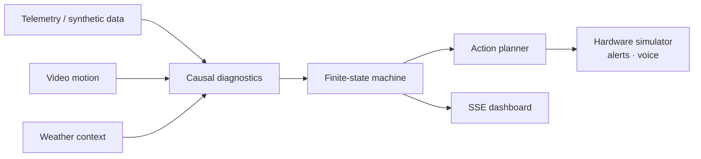

<h1 align="center">AquaBro</h1>
<p align="center"><b>A deterministic multi-agent monitoring loop for recirculating aquaculture.</b></p>

## ▍Project gallery

<table><tr>
<td width="50%"></td>
<td width="50%"></td>
</tr></table>

<sub>Images from the [project portfolio](https://bede-lau.github.io/); they may depict an earlier build.</sub>


## ▍At a glance



The demo includes simulated hardware and mock-aware integrations; see the manual tasks and runtime assumptions below.

---

A hybrid, fault-tolerant AI system for commercial Recirculating Aquaculture
Systems (RAS). Deterministic multi-agent reasoning loop + biochemical math
models + computer vision — **not** an LLM wrapper. Built to stay reliable in
messy, high-stakes physical environments where sensor drift and latency kill
biomass.

> Hackathon product name in the spec: **AquaPulse AI**. Codebase name: **AquaBro**.

---

## Architecture (one Python process + Postgres + React frontend)

```
                          ┌──────────────── PostgreSQL ────────────────┐
                          │  telemetry_logs · auto_feed_logs · agent_events │
                          └────────────────────▲──────────────────────┘
                           │                   │ persist
  Zenodo MP4 ──▶ Vision ──┤                   │
  (RTSP sim)   (motion)   │                   │
  CSV/synth ───▶ Telemetry─┼─▶ Causal Diagnostics ──(FSM)──▶ Action Planner
  OpenWeather ─▶ Context ──┘    │ in-memory causal graph         │ HTTP POST →
                                │ NH₃ / hypoxia / feed math      │  hardware sim
                                ▼                                │  Telegram
                              SSE bus ──▶ React dashboard        │  ElevenLabs voice
```

**Why no Neo4j / Node:** the causal "graph" is small static domain knowledge
(Sensor→Parameter→Risk→Hardware). Modeling it in-process avoids a database hop per reasoning tick and removes one
service dependency in the demo. No comparative accuracy or latency benchmark is
claimed. The UI renders the same graph structure as
an interactive panel — the "knowledge graph" narrative is preserved.

---

## ▍The incident loop

| Input or boundary | Behavior |
| --- | --- |
| **Telemetry** | CSV or synthetic sensor data enters the monitoring loop. |
| **Vision** | A local video feed simulates RTSP input; motion detection and a YOLO stub have different capabilities. |
| **Diagnostics** | In-process causal rules and biochemical models evaluate sensor-to-risk relationships. |
| **State** | A deterministic state machine tracks normal, at-risk, critical, mitigating and recovering states. |
| **Response** | The action planner targets a hardware simulator and can send alerts through configured integrations. |
| **Observation** | The React dashboard receives events through SSE; PostgreSQL persists recorded data. |

The simulator, mock integrations and synthetic telemetry are useful for exercising the flow. They do not establish sensor accuracy, fail-safe hardware operation or suitability for unattended aquaculture.

---


## Quick start

### 1. Infra

> ⚠️ **Python 3.12 required.** Do NOT use Python 3.14 (the current default on
> this machine). `asyncpg` and `pydantic-core` ship no 3.14 wheels, so `pip`
> falls back to a source build that fails (PyO3 caps at 3.13; asyncpg's C
> code won't compile against the 3.14 C API). Bare `python`/`pip` resolves to
> global 3.14 — always use the venv (see below).

```bash
docker compose up -d postgres          # Postgres on :5432

# Windows — create a Python 3.12 venv with uv (uv venvs are pip-less by design)
uv venv --python 3.12 .venv
uv pip install -r backend/requirements.txt
cp .env.example .env                    # then edit (see Manual Tasks)
```

<details><summary>No uv? Plain venv works too (still Python 3.12)</summary>

```cmd
py -3.12 -m venv .venv
.venv\Scripts\activate.bat
python -m pip install -r backend/requirements.txt
```
</details>

### 2. Backend

Run from the project root (`--app-dir backend` puts `backend\` on `sys.path` so
`app.main:app` resolves, and keeps cwd at the repo root for `.env`/data paths).

**Windows — cmd.exe:**
```cmd
.venv\Scripts\activate.bat
uvicorn app.main:app --reload --app-dir backend
```

**Windows — PowerShell:**
```powershell
.\.venv\Scripts\Activate.ps1
uvicorn app.main:app --reload --app-dir backend
```

**No activation (works in any shell) — uses the venv's python directly:**
```cmd
.venv\Scripts\python.exe -m uvicorn app.main:app --reload --app-dir backend
```

```bash
# API:      http://localhost:8000
# Docs:     http://localhost:8000/docs
# SSE:      http://localhost:8000/api/stream
# Vision:   http://localhost:8000/api/vision/stream  (MJPEG)
```

### 3. Frontend
```bash
cd frontend && npm install && npm run dev   # http://localhost:5173
```

### 4. Run the demo
Open the dashboard → click **Inject pH Spike** / **Inject DO Crash** in the
Chaos panel, or hit **Narrator** to auto-run the full 3-minute script on a
timer. See §"Manual tasks" below for keys + dataset.

---

## Manual tasks (do these before the demo)

See [`docs/MANUAL_TASKS.md`](docs/MANUAL_TASKS.md) for the full checklist. Summary:

1. **Zenodo dataset** — DOI `10.5281/zenodo.17518786`. Drop 30s MP4 clips into
   `data/clips/` and `meta_tilapia_set.csv` into `data/`. App falls back to
   synthetic telemetry if absent.
2. **API keys** — OpenWeatherMap, Telegram (bot token + chat id), ElevenLabs.
   Missing key ⇒ that channel runs in MOCK mode; app still runs.
3. **Docker Desktop** — for Postgres.
4. **ngrok** — only if wiring the ElevenLabs voice webhook live.

---

## Project layout
```
backend/app/
  main.py            FastAPI app, routes, SSE, webhooks, hardware sim
  config.py          env-driven settings (graceful fallbacks)
  db.py · models.py · schemas.py
  causal/
    graph.py         in-memory causal graph (nodes/edges) + mitigation lookup
    math_models.py   NH₃ fraction (pKa(T)), hypoxia T-critical, feed control
    fsm.py           deterministic state machine + transitions
  agents/            telemetry(verify) · context · causal · action
  vision/            broadcaster (RTSP sim) · motion detector · yolo stub
  engine.py          ingest loop + agent pipeline + FSM driver + narrator
  integrations/      telegram · elevenlabs · openweather  (mock-aware)
frontend/            Vite + React + TS dark-industrial dashboard
tests/               math_models · fsm · telemetry-verify
docs/MANUAL_TASKS.md keys + dataset retrieval checklist
```

## Tests
```bash
pytest backend/tests -q
```
